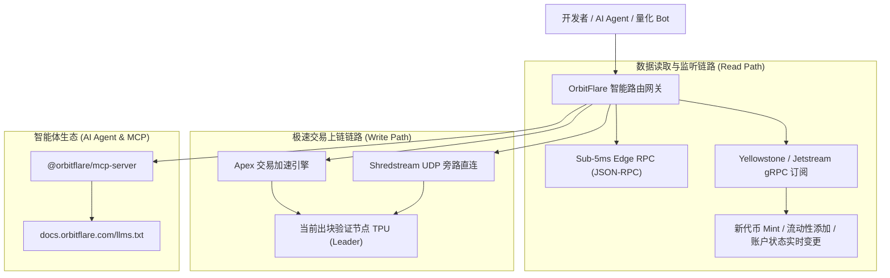

# OrbitFlare Solana 高性能极速 RPC 与 AI Agent 基础设施中文开发者全景技术指南
*OrbitFlare Architecture, Yellowstone gRPC, Shredstream UDP & AI Agent MCP Integration Manual (Simplified Chinese)*

> [!IMPORTANT]
> **作者/贡献者**：Web3 独立研究员  
> **贡献者收款钱包**：  
> - **Solana (SPL)**：`BF2pfru1ctS18uG2Si1nGGGirb7cXUghG4aSpD7zs4DG`  
> - **EVM (Base / Arbitrum / ETH)**：`0x48F0c2aAe90D5Cc5DA94Ac6A17B52FA9763099c1`  
> - **TRON (TRC20)**：`TRMYDmUGGwMLbpvEirnCW9imWPwCUkpSM1`  
> **官方项目参考**：[OrbitFlare 官网](https://orbitflare.com) | [文档中心](https://docs.orbitflare.com) | [Discord](https://discord.gg/orbitflare) | [Twitter](https://twitter.com/OrbitFlare)

---

## 一、 为什么华语 Solana 开发者急需 OrbitFlare？

在 2026 年的 Solana 生态中，去中心化交易（Raydium、Meteora、Pump.fun）、MEV 套利与自主 AI Agent 自动化已成为链上交互的核心主力。然而，绝大多数华语量化团队、Bot 开发者以及 AI Agent 智能体构建者，长期受困于公共 RPC 的**高延迟（>100ms）、WebSocket 丢包、TPU 交易拥堵被丢弃**等痛点。

**OrbitFlare** 作为下一代 Solana 极速基础设施，通过重构底层数据链路，提供了三项核心技术突破：
1. **Sub-5ms 超低延迟 RPC 节点**：全球分布式边缘加速，彻底击穿传统 HTTP 轮询的延迟墙；
2. **Yellowstone & Jetstream gRPC 毫秒级流式数据总线**：相较于传统 WebSocket，吞吐量提升 10 倍以上，0 丢包监听链上新池创建与大单交易；
3. **Shredstream UDP 与 Apex 交易极速直达**：直连当前 Slot 的出块验证节点（Leader Validator TPU），交易免排队极速上链，避免抢跑失败；
4. **原生 AI Agent 与 MCP（模型上下文协议）支持**：专为 Claude Code、Cursor、Windsurf 等自主 AI 代理提供标准化 Tool Schema 和安全护栏。

---

## 二、 核心架构技术深度拆解



### 1. Yellowstone gRPC 对比传统 WebSocket
传统 WebSocket 在高频行情下，因 TCP 队头阻塞与 JSON 反序列化开销，经常导致订阅延迟累积至数秒甚至连接断开。OrbitFlare 的 Yellowstone gRPC 采用 Protobuf 二进制序列化与 HTTP/2 双向流，实现微秒级账户过滤器（Account Filter）与交易订阅：
- **过滤精准度**：可按 Program ID、账户 Owner、Data Offset 毫秒级筛选；
- **并发能力**：单连接支持万级订阅，极度适配高频 DEX 监控。

### 2. Shredstream 与 Apex 交易落地机制
在 Solana 高拥堵时段，普通节点的 `sendTransaction` 往往被排队缓冲池（Buffer Pool）丢弃。
- **Shredstream**：利用 UDP 数据报文直接向网络广播原始交易数据分片（Shreds），以光速穿透节点路由；
- **Apex 加速**：实时跟踪 Solana 验证节点的 Slot Leader 调度日程（Leader Schedule），直接将签名交易定向投递给下一个打包 Slot 的验证者。

---

## 三、 开发者极速上手代码实战

### 1. Node.js / TypeScript: 极速安装与 MCP Server 挂载

OrbitFlare 为现代 AI 工具（Cursor / Claude Code）提供了官方技能包：

```bash
# 1. 极速挂载 OrbitFlare AI Skills
npx @orbitflare/skills@latest

# 2. 或在项目内安装核心开发工具包
npm install @orbitflare/mcp-server @solana/web3.js
```

在 `mcp.json` 或 AI 工具配置文件中集成：
```json
{
  "mcpServers": {
    "orbitflare": {
      "command": "npx",
      "args": ["-y", "@orbitflare/mcp-server"],
      "env": {
        "ORBITFLARE_API_KEY": "your_api_key_here",
        "SOLANA_NETWORK": "mainnet-beta"
      }
    }
  }
}
```

---

### 2. Python 实战：Yellowstone gRPC 极速监听 Raydium / Pump.fun 新池

```python
import asyncio
from orbitflare import OrbitFlareClient

async def watch_pump_fun_mints():
    # 初始化 OrbitFlare 极速客户端
    client = OrbitFlareClient(
        api_key="your_orbitflare_api_key",
        grpc_endpoint="https://grpc.mainnet.orbitflare.com:443"
    )
    
    print("🚀 连接 OrbitFlare Yellowstone gRPC 节点成功，正在秒级监听...")
    
    # 订阅目标程序事件（例如 Pump.fun 核心合约）
    PUMP_PROGRAM = "6EF8rrecthR5Dkzon8Nwu78hRvfCKubJ14M5uBEwF6P"
    
    async for tx in client.subscribe_program_transactions(PUMP_PROGRAM):
        slot = tx.slot
        signature = tx.transaction.signatures[0]
        print(f"⚡ [Slot {slot}] 捕获最新交易: {signature}")

if __name__ == "__main__":
    asyncio.run(watch_pump_fun_mints())
```

---

### 3. Rust 实战：Apex 极速交易发送与落地（0 拥堵）

```rust
use solana_sdk::transaction::Transaction;
use orbitflare_sdk::ApexClient;

#[tokio::main]
async fn main() -> Result<(), Box<dyn std::error::Error>> {
    let apex = ApexClient::new("https://apex.mainnet.orbitflare.com", "YOUR_API_KEY");

    // 假设 tx 是已签名的代币买入或套利交易
    let tx: Transaction = build_and_sign_my_tx();

    // 经由 OrbitFlare Apex 引擎直达当前 Slot Leader TPU
    let signature = apex.send_and_confirm_transaction_fast(&tx).await?;
    println!("✅ 交易已极速落块确认: {}", signature);

    Ok(())
}
```

---

## 四、 客户 API v2 安全管理规范

OrbitFlare Customer API v2 提供了完整的无头（Headless）密钥与白名单自动化管理：

1. **钱包签名认证（Sign-in with Solana）**：
   - 调用 `/auth/wallet/challenge` 获取 Ed25519 签名 Nonce；
   - 使用私钥完成签名后调用 `/auth/wallet/verify` 换取 Bearer Token，无需繁琐账号密码。
2. **动态 IP 与域名白名单**：
   - 支持通过 API 动态为运行在 AWS/GCP 的多台海外交易 Bot 自动添加/移除出口 IP：
   - `POST /customer-endpoints/licenses/add-ip`。

---

## 五、 团队直联与认领文案（Direct Outreach Pack）

> 以下为针对 OrbitFlare 官方团队的自荐英文信，可直接发送至 **OrbitFlare Discord**（`#dev-chat` 或私信管理员）或在 **Twitter/X 私信 `@OrbitFlare` / `@OrbitFlareNodes`**：

```text
Subject: Comprehensive Simplified Chinese Developer Manual for OrbitFlare Ecosystem

Hi OrbitFlare Team (@OrbitFlare)! 🚀

Chinese bot builders, quantitative traders (Pump.fun, Raydium DLMM), and autonomous AI agent developers currently account for a massive share of high-throughput Solana on-chain volume. However, the existing OrbitFlare documentation (148 pages) is strictly English-only, creating an onboarding barrier for the Asian developer community.

To help expand OrbitFlare's market penetration and developer adoption in the Chinese-speaking Web3 ecosystem, I have authored and published a comprehensive, production-ready "OrbitFlare Solana Architecture & Developer Manual (Simplified Chinese)".

It covers:
1. Sub-5ms RPC & Yellowstone gRPC streaming architecture compared to legacy WebSocket;
2. Shredstream UDP & Apex direct-to-leader TPU transaction landing pipelines;
3. Step-by-step MCP (@orbitflare/mcp-server) integration for AI agent platforms (Cursor, Claude Code);
4. Multi-language production code snippets (Python, TypeScript, Rust).

📄 You can review the full Chinese manual here:
https://github.com/Oepjdihc2008/orbitflare-chinese-manual

If the OrbitFlare team finds this manual valuable, you are welcome to incorporate it into your official docs (docs.orbitflare.com) to serve Chinese-speaking developers. If your team has a Community Contributor Grant or Ecosystem Bounty fund, you can support this localization initiative via my Solana SPL address:

Multi-Chain Contributor Addresses:
- Solana SPL (USDC / USDT / SOL): BF2pfru1ctS18uG2Si1nGGGirb7cXUghG4aSpD7zs4DG
- EVM (Base / Arbitrum / ETH): 0x48F0c2aAe90D5Cc5DA94Ac6A17B52FA9763099c1
- TRON (TRC20-USDT): TRMYDmUGGwMLbpvEirnCW9imWPwCUkpSM1

Looking forward to seeing OrbitFlare power the next generation of Solana high-speed agents! Keep building! 🔥
```
